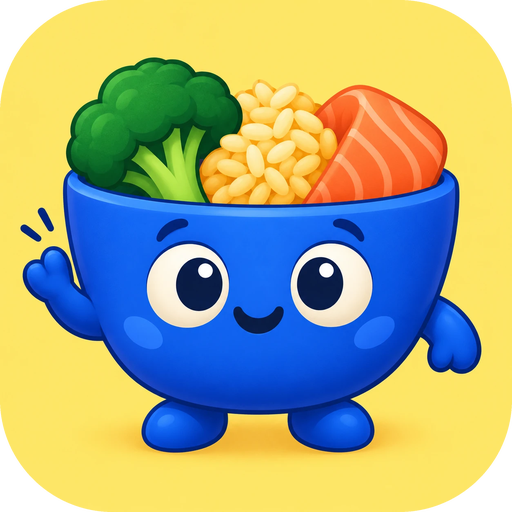
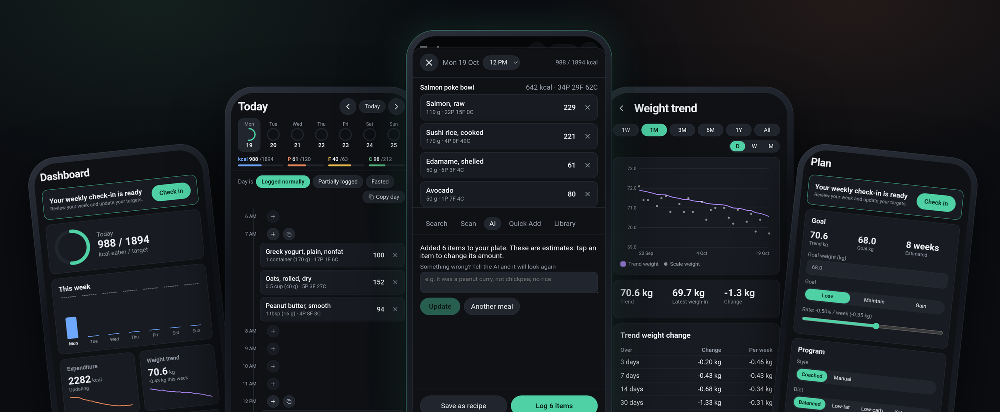
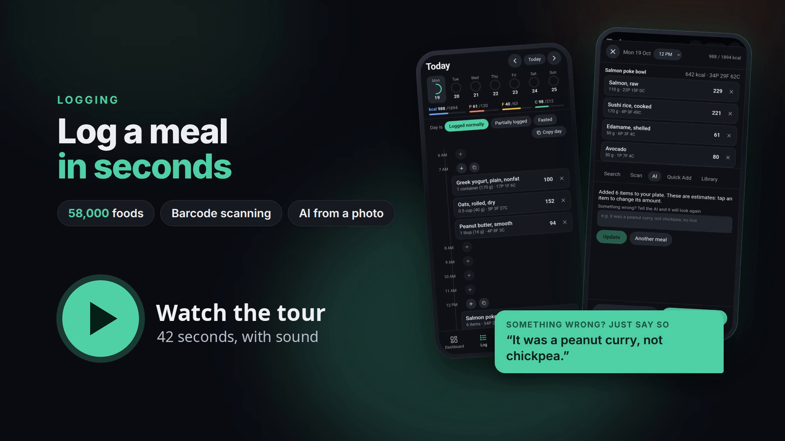
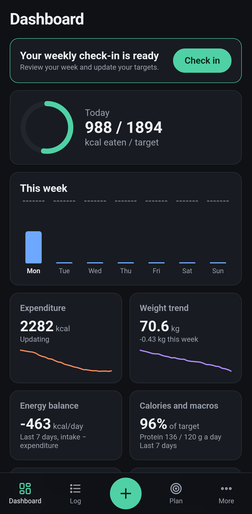
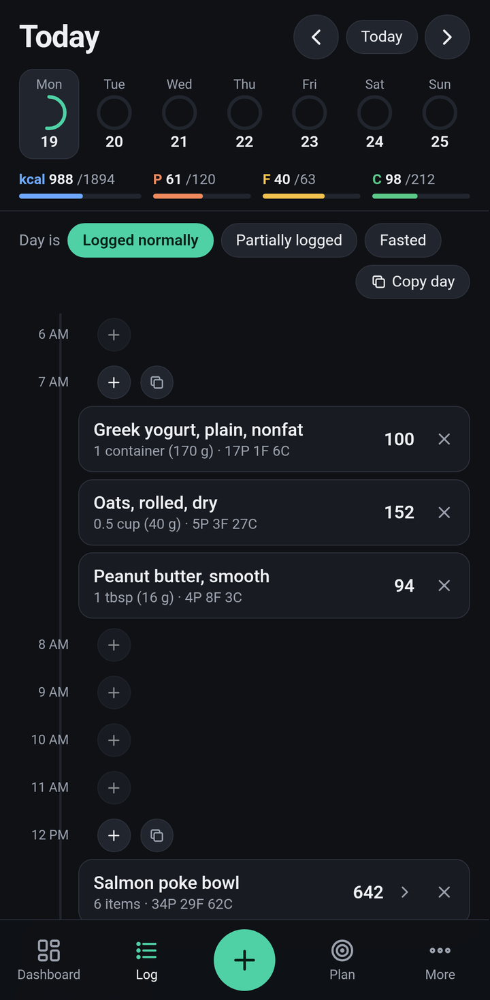
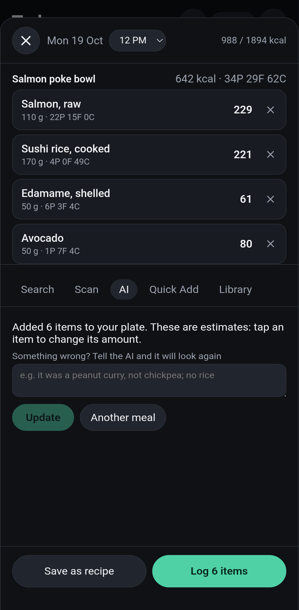
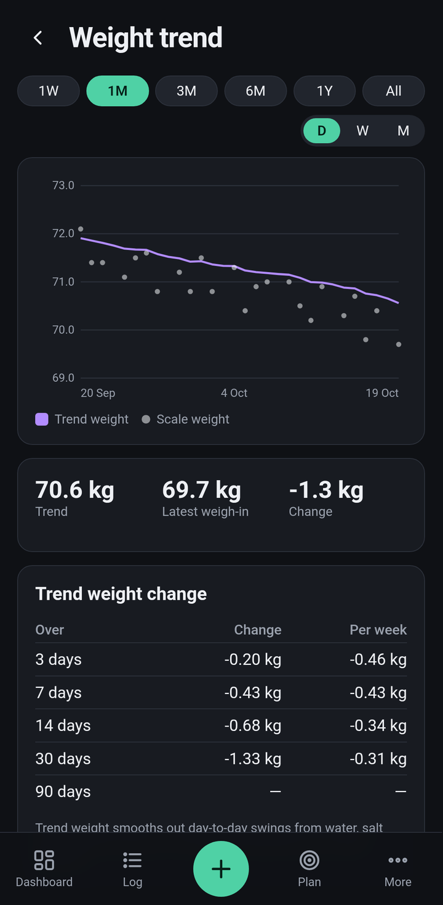
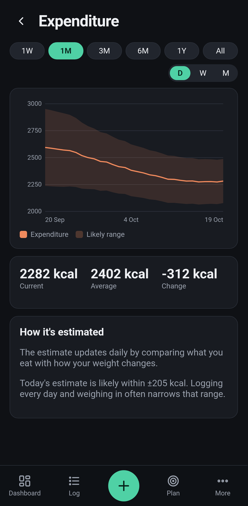
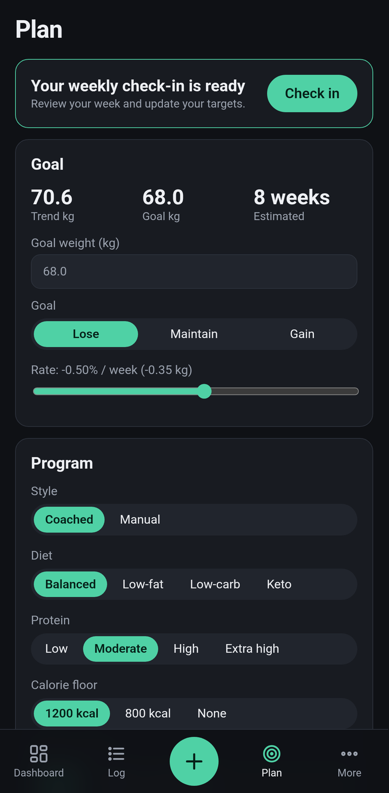

  

<h1 align="center">OpenMacro</h1>

  <b>The open-source nutrition coach.</b> 
  Calorie and macro targets that adapt to your body, logging in seconds (even from a photo), 
  and your data stays on your phone.

  
  
  
  
  
  

  <a href="https://github.com/SilverCrocus/OpenMacro/releases/latest"><b>Download for Android</b></a>
  &nbsp;·&nbsp;
  <a href="#features">Features</a>
  &nbsp;·&nbsp;
  <a href="#ai-logging">AI logging</a>
  &nbsp;·&nbsp;
  <a href="CONTRIBUTING.md">Contribute</a>

  

## Why OpenMacro?

Most calorie apps give you a target from a formula and leave it there. OpenMacro **works out what you actually burn** from what you eat and how your weight changes, and updates your targets every week. It's the same evidence-based approach as the best paid coaching apps, but free and open.

- 🎯 **Coaching that adapts.** Your expenditure is estimated from your own data, with a weekly check-in that adjusts calories and macros to your goal: lose, maintain or gain.
- ⚡ **Fast logging.** Search 58,000 foods, scan barcodes, reuse recipes and recent foods, copy whole meals, or snap a photo and let AI fill in the plate.
- 🔒 **Yours.** No account, no subscription, no ads, no tracking. Your data lives on your phone and works offline, with backups, CSV export and Health Connect sync.
- 🛠️ **Open.** MIT licensed and written in Rust. Read how every number is calculated in [the algorithms doc](docs/ALGORITHMS.md).

## See it in 40 seconds

  

## Features

<table>
  <tr>
    <td align="center"> <b>Dashboard</b> Today's intake, expenditure, weight trend and habits at a glance</td>
    <td align="center"> <b>Food log</b> A timeline by hour; AI meals show as one row</td>
    <td align="center"> <b>AI logging</b> Photo or description in, foods and amounts out</td>
  </tr>
  <tr>
    <td align="center"> <b>Weight trend</b> A smoothed trend that sees past daily water swings</td>
    <td align="center"> <b>Expenditure</b> What you really burn, with its likely range</td>
    <td align="center"> <b>Plan</b> Your goal, rate, diet style and weekly check-in</td>
  </tr>
</table>

**Coaching**
- Adaptive expenditure (TDEE) estimate with an uncertainty band, starting from Mifflin-St Jeor, Katch-McArdle or Cunningham
- Goals to lose, maintain or gain at a chosen rate; coached or manual programs; weekly calorie shifting
- Balanced, low-fat, low-carb and keto macro splits, from low to extra-high protein
- Weekly check-ins that review your week before changing your targets

**Logging**
- 58,000 foods from USDA FoodData Central, the Australian Food Composition Database and Open Food Facts
- Live barcode scanning, with Open Food Facts lookup for products not in the database
- Custom foods, recipes with cooked weights, favourites, recent foods and quick add
- Copy a meal or a whole day; a timeline by hour; water tracking
- AI logging from a photo or a description, with corrections in plain words

**Insights**
- Expenditure, weight trend, energy balance, calories and macros, goal progress and body measurements, with 1W–All ranges
- Fibre, vitamins and minerals against standard targets for your age and sex, with the top sources of each

**Your data**
- Stored on your phone; works offline
- Backups to one file, CSV export, and Health Connect sync (weight and body fat in; food, water and weight out)
- kcal or kJ, kg or lb, dark or light theme

## AI logging

Take a photo of your meal, or just describe it ("two eggs on toast with butter"). The AI lists the foods with their weights and puts them on your plate to check before you log. If something's wrong, tell it in plain words, such as "it was a peanut curry, not chickpea", and it looks again.

**Bring your own key.** Use any of these:
- **Google Gemini:** free tier available.
- **OpenRouter:** one key for hundreds of models.
- **OpenAI** or **Anthropic.**
- **Any OpenAI-compatible service,** including Ollama on your own computer.

A photo costs well under a cent. Nothing is sent anywhere unless you log with AI, and your key never leaves your phone or goes into backups.

**We measured which model to recommend.** We tested 7 small models on [100 photos of weighed meals](docs/AI_PHOTO_EVAL.md):

| Model | Average error | Time per photo | Cost per 1,000 photos |
|---|---|---|---|
| **Gemini 3.1 Flash Lite** (default) | 88 kcal | 2.4 s | $0.67 |
| Gemini 3.8 Flash | 88 kcal | 5.1 s | $2.08 |
| Gemma 4 26B (open weights) | 98 kcal | 4.7 s | $0.08 |
| Claude Haiku 5.5 | 109 kcal | 5.0 s | $0.45 |

## Install

1. Download the latest APK from [Releases](https://github.com/SilverCrocus/OpenMacro/releases/latest). Most phones need the `arm64-v8a` one.
2. Open it, and allow your browser or file manager to install apps if Android asks.
3. That's it. OpenMacro checks for new versions when it opens and updates itself.

You can also add the repository to [Obtainium](https://github.com/ImranR98/Obtainium) to get updates. An iPhone version isn't available yet.

## Contributing

Contributions are very welcome, whether code, design, docs, food data or bug reports.
- **Getting started:** [CONTRIBUTING.md](CONTRIBUTING.md) explains how to set up (the web preview runs with one command) and how to pick something to work on.
- **What's next:** the [roadmap](docs/ROADMAP.md) lists what's planned.
- **Building and releasing:** see [docs/DEVELOPMENT.md](docs/DEVELOPMENT.md).

Built with [Rust](https://www.rust-lang.org) and [Dioxus](https://dioxuslabs.com), with SQLite for storage.

## Clean-room policy

OpenMacro is an independent project, inspired by adaptive coaching apps such as MacroFactor. It is not affiliated with, endorsed by, or connected to MacroFactor or Stronger By Science.
- **No copied code or assets:** the repository contains no proprietary source code, decompiled code, binaries or assets (icons, images, copy, fonts) from other apps.
- **Written from our own specs:** the specs in `docs/` describe behaviour in our own words, and the code is written from them and from public science.

OpenMacro gives general nutrition information, not medical advice.

## License

The code is under the MIT license; see [LICENSE](LICENSE). The food database has its own licences: USDA (public domain), FSANZ (CC BY 4.0) and Open Food Facts (ODbL). See [docs/FOOD_DATA.md](docs/FOOD_DATA.md).
